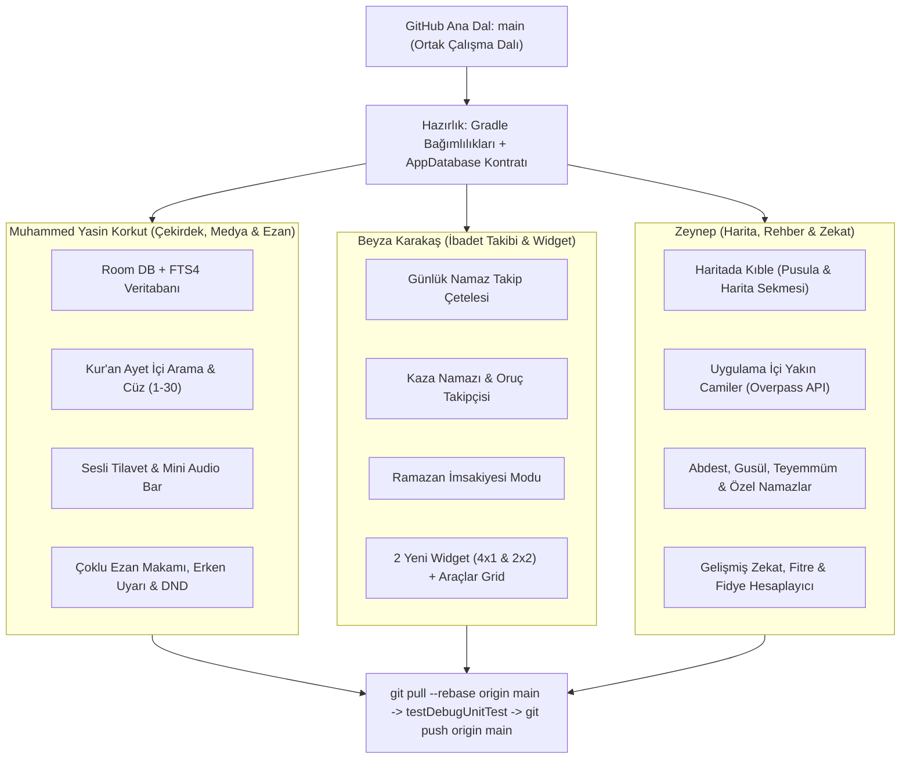

# Hilalim — Etap 2 (v1.2.0) Geliştirme & UI/UX Planı

> **Hedef Sürüm:** `1.2.0` (`versionCode: 7`)  
> **Ekip:** **Muhammed Yasin Korkut** (Teknik Lider / Çekirdek & Medya), **Beyza Karakaş** (İbadet Takibi & Widget), **Zeynep** (Harita/Kıble, Rehber & Finansal Araçlar)  
> **Tahmini Süre:** 3–4 Hafta (3 Sprint)

---

## 1. Ortak Tasarım Sistemi (UI/UX Standartları)

Üç geliştiricinin ürettiği tüm ekranların **tek elden çıkmış gibi** görünmesi için mevcut projedeki tema token'ları ve bileşen ölçüleri aynen korunacaktır:

### 1.1 Renk & Tema Token'ları ([colors.xml](file:///d:/Hilalim/app/src/main/res/values/colors.xml) & [values-night/colors.xml](file:///d:/Hilalim/app/src/main/res/values-night/colors.xml))
| Kullanım | Token / Drawable | Light | Dark |
| :--- | :--- | :--- | :--- |
| **Ekran Arka Planı** | `?attr/colorSurface` | `#F8F9FA` | `#111415` |
| **Kart Arka Planı** | `?attr/colorSurfaceContainer` | Beyaz / Açık Yüzey | `#323536` |
| **Koyu Hero Kart** | `@drawable/bg_dark_gradient_card` | Koyu Gradyan | Koyu Yeşil/Siyah |
| **Ana Vurgu (Primary)** | `?attr/colorPrimary` | `#735C00` | `#F2CA50` |
| **İkincil Vurgu (Altın)** | `@color/secondary` / `@color/gold` | `#D4AF37` | `#D4AF37` |
| **Seçili/Aktif Arka Plan** | `@color/selected_lang_bg` | `%8` Altın | `%15` Altın |
| **Kart Kenarlığı** | `@color/card_stroke` | `%20` Altın (`1dp`) | `%20` Altın (`1dp`) |
| **İkon Kutusu** | `@drawable/bg_tool_icon` / `@drawable/bg_hero_icon` | — | — |
| **Metin (Ana / İkincil)** | `?attr/colorOnSurface` / `?attr/colorOnSurfaceVariant` | `#191C1D` / `#4D4635` | `#E1E3E4` / `#D0C5AF` |

### 1.2 Sabit Ölçü ve Davranış Kuralları
- **BaseActivity Zorunluluğu:** Tüm yeni `Activity` sınıfları [BaseActivity.java](file:///d:/Hilalim/app/src/main/java/com/korkutsoftware/hilalim/BaseActivity.java) sınıfından türemeli, `EdgeToEdge.enable(this)` ve `applySystemBarInsets(findViewById(android.R.id.content))` çağırmalıdır.
- **Kart Yuvarlaklığı:** Hero kartlar `24dp`, standart içerik kartları `20dp`, liste satırları `16dp`, hap/rozet (`pill`) bileşenleri `12–14dp` olmalıdır.
- **Sayfa Kenar Boşluğu:** Yatay `16dp` veya `20dp`; kartlar arası dikey boşluk `12–14dp`.
- **Üst Başlık (Header) Standardı:** `SurahDetailActivity` / `AboutActivity` stilindeki `bg_dark_gradient_card` yuvarlak hero header veya `@color/header_bg` (`64dp`) bar kullanılmalı; geri ok butonu `@drawable/ic_back_arrow` (`rotation` koymadan!) kullanmalıdır.
- **Çoklu Dil Kuralı:** Eklenen her metin **4 dil dosyasına** (`values`, `values-en`, `values-de`, `values-ar`) eklenmelidir; XML içine doğrudan Türkçe metin yazılmamalıdır.
- **Reklam Hassasiyeti:** Kur'an okuma, Zikirmatik, Namaz Takibi ve Abdest/Namaz Rehberi içi etkileşimlerde tam ekran geçiş reklamı (`Interstitial`) gösterilmez.

---

## 2. İş Bölümü Özeti (Çakışmasız Modül Haritası)



---

## 3. Geliştirici Görevleri & Detaylı UI Spesifikasyonları

---

### A. MUHAMMED YASİN KORKUT — *Kur'an Motoru, Sesli Tilavet, Room DB & Gelişmiş Ezan*

#### Görev A1: Room Veritabanı Altyapısı (`data/db/`)
- **Bağımlılıklar (`gradle/libs.versions.toml` & `app/build.gradle`):**
  - `androidx.room:room-runtime` + `annotationProcessor` (`room-compiler`)
  - `androidx.media3:media3-exoplayer` + `media3-session`
  - `androidx.work:work-runtime`
- **Oluşturulacak Sınıflar (`com.korkutsoftware.hilalim.data`):**
  - `AppDatabase.java` (Singleton, `version = 1`)
  - `QuranVerseEntity.java` (`id`, `surahId`, `verseId`, `juz`, `page`, `arText`, `trText`) + `QuranVerseFts.java` (`@Fts4`)
  - `QuranDao.java` (`getVersesBySurah`, `getVersesByJuz`, `searchVerses(query)`, `insertAll`)
  - `PrayerLogEntity.java` & `PrayerLogDao.java` *(Beyza'nın modülüyle ortak şema — Bölüm 4'te detaylandırıldı)*
  - `QuranImportHelper.java` — İlk açılışta `quran_verses.json` verisini arka planda tek seferde Room'a aktarır (`SharedPreferences` bayrağı: `quran_db_imported_v1`).

#### Görev A2: Kur'an Ayet İçi Arama & Cüz Navigasyonu (`QuranFragment` + `SurahDetailActivity`)
- **UI Tasarımı (`fragment_quran.xml` güncellemesi):**

```
┌─────────────────────────────────────────┐
│ [📖] Kur'an-ı Kerim                     │
│      114 Sure • Sesli & Arama Destekli  │
├─────────────────────────────────────────┤
│ 🔍 Sure veya ayet meali ara...      [✕] │
├─────────────────────────────────────────┤
│ [Sureler] [Ayet Ara] [Cüzler] [Yer İmi] │  <-- Yatay ChipGroup (4 Chip)
├─────────────────────────────────────────┤
│ ╔═════════════════════════════════════╗ │
│ ║ KALDIĞIN YERDEN DEVAM ET         ➔ ║ │  <-- bg_dark_gradient_card
│ ║ 2. Sure • Bakara • 142. Ayet        ║ │
│ ╚═════════════════════════════════════╝ │
├─────────────────────────────────────────┤
│  1   Fatiha                  الفاتحة   │
│      7 Ayet • Mekki                     │
├─────────────────────────────────────────┤
│  2   Bakara                   البقرة   │
│      286 Ayet • Medeni                  │
└─────────────────────────────────────────┘
```

- **Davranış:**
  - `Ayet Ara` chip'i seçiliyse arama kutusuna en az 3 karakter girildiğinde `QuranDao.searchVerses()` çalışır; sonuç listesinde sure adı, ayet numarası (`2:153`) ve eşleşen meal metni gösterilir; tıklayınca `SurahDetailActivity` tam o ayete açılır.
  - `Cüzler` chip'i seçiliyse 1–30 Cüz kartları listelenir; her kartta Cüz numarası ve başlangıç suresi/ayeti yazar.

#### Görev A3: Sesli Kur'an Tilaveti & Mini Audio Bar (`SurahDetailActivity` + `QuranAudioService`)
- **UI Tasarımı (`activity_surah_detail.xml` altına sabit Mini Player):**

```
┌───────────────────────────────────────────────────────────┐  <-- Header (Geri | Bakara | Aa | < | > | [🔊 Hafız])
│  [1]                                    [♡] [📤] [📋]     │
│  الْحَمْدُ لِلَّهِ رَبِّ الْعَالَمِينَ                      │  <-- Çalan ayette altın stroke (2dp) + selected_lang_bg
│  Hamd, âlemlerin Rabbi Allah'a mahsustur.                 │
├───────────────────────────────────────────────────────────┤
│ ╔═══════════════════════════════════════════════════════╗ │  <-- Mini Audio Player Bar (Yalnızca çalarken/seçilince görünür)
│ ║ [▶ / ⏸]  Bakara • 2. Ayet        [1x ↻] [⏮] [⏭] [✕] ║ │      bg_dark_gradient_card, height: 68dp, radius: 20dp
│ ║ ━━━━━━━━━━●─────────────────  00:08 / 00:21           ║ │      Alafasy • Mishary Rashid
│ ╚═══════════════════════════════════════════════════════╝ │
└───────────────────────────────────────────────────────────┘
```

- **Bileşen Detayları:**
  - Her ayet kartına (`item_verse.xml`) küçük bir `btn_play_verse` (`ic_play_arrow` / `ic_volume_up`) ikonu eklenir.
  - **Hafız Seçici Dialog:** En az 3 hafız (örn. *Mishary Rashid Alafasy*, *Mahmoud Khalil Al-Husary*, *Abdul Basit*). Ses dosyaları `https://everyayah.com/data/{reciterFolder}/{surah3}{verse3}.mp3` formatıyla stream edilir ve son çalınan sure önbelleklenebilir.
  - **Tekrar Modu (`1x` / `3x` / `5x`):** Ezber yapan kullanıcılar için aynı ayeti seçilen sayı kadar tekrarladıktan sonra otomatik sonraki ayete geçer ve `RecyclerView` otomatik kayar (`smoothScrollToPosition`).
  - **Arka Plan Oynatma:** `QuranAudioService` (`foregroundServiceType="mediaPlayback"`) bildirim panelinde Oynat/Duraklat/Sonraki kontrollerini gösterir.

#### Görev A4: Çoklu Ezan Makamı, Özel Erken Uyarı & Namazda Sessiz Modu
- **UI Tasarımı (`activity_notification_settings.xml` genişletmesi):**
  - **"Ezan Sesi Seçimi"** kartı (Radio Dialog veya liste):
    1. *Klasik Ezan (Dahili)* (`R.raw.ezan`)
    2. *İstanbul Makamı* (indirilebilir/cache'li veya `raw` ses)
    3. *Mekke / Medine Ezanı*
    4. *Kısa Tekbir / Uyarı Sesi*
    5. *Sadece Sessiz Bildirim*
  - **"Erken Uyarı Süresi"** seçim satırı: Sabit 45/15 yerine `15 / 30 / 45 / 60 dk` çoklu/slider seçimi (özellikle Ramazan'da İmsak öncesi `60 dk`).
  - **"Namaz Vaktinde Sessize Al" (DND)** anahtarı (`NotificationManager.isNotificationPolicyAccessGranted()` kontrolüyle izin alıp vakitten +5 dk sonra telefonu 20 dk titreşime/sessize alma).

---

### B. BEYZA KARAKAŞ — *Namaz & Kaza Takipçisi, Ramazan İmsakiyesi & Yeni Widget'lar*

#### Görev B1: Günlük Namaz Takip Çetelesi (`NamazTakipActivity` + `HomeFragment` özet şeridi)
- **Hedef:** Kullanıcının günlük 5 vakti (+ Vitir) tek dokunuşla işaretleyip aylık alışkanlık serisi (streak) oluşturması.
- **UI Tasarımı (`activity_namaz_takip.xml`):**

```
┌─────────────────────────────────────────┐
│ [←]         Namaz Takibim         [📅]  │  <-- Header (header_bg, 64dp)
├─────────────────────────────────────────┤
│ ╔═════════════════════════════════════╗ │
│ ║ 🔥 12 Günlük Seri      %86 Bu Ay   ║ │  <-- Hero Card (bg_dark_gradient_card)
│ ║ P  S  Ç  P  C  C  P                 ║ │      7 günlük mini daire göstergeleri
│ ║ ●  ●  ●  ●  ◐  ○  ○                 ║ │      (● Tamam = Altın, ◐ Kısmi, ○ Boş)
│ ╚═════════════════════════════════════╝ │
├─────────────────────────────────────────┤
│  ‹    25 Kasım 2026 (Bugün)         ›   │  <-- Gün değiştirme çubuğu
├─────────────────────────────────────────┤
│ ┌─────────────────────────────────────┐ │
│ │ 🌅 Sabah        [Kıldım] [Cemaat]   │ │  <-- Her vakit için MaterialCardView (18dp)
│ └─────────────────────────────────────┘ │      Durum butonları:
│ ┌─────────────────────────────────────┐ │      - Kıldım (Altın dolu pill)
│ │ ☀ Öğle         [Kıldım] [Kaza]     │ │      - Cemaatle (Yeşil/Altın rozet)
│ └─────────────────────────────────────┘ │      - Kaza (Gri/Uyarı çerçeve)
│ ┌─────────────────────────────────────┐ │
│ │ 🌤 İkindi       [Bekliyor...]       │ │
│ └─────────────────────────────────────┘ │
│  ... (Akşam, Yatsı, Vitir)              │
└─────────────────────────────────────────┘
```

- **Ana Sayfa (`HomeFragment`) Mini Entegrasyonu:**
  - `HomeFragment` üzerinde 6 vakit kartının sağ tarafına küçük tıklanabilir onay ikonu (veya vakit kartına uzun basma / tek dokunuş "Kıldım ✓" chip'i) ya da "Vakitler" başlığının yanında `Namaz Takibim ➔` kısayol hapı yer alır. *(Not: `HomeFragment.java` çakışmasını önlemek için önce Beyza kendi Activity ve DAO'sunu tamamlar, son adımda Yasin ile `HomeFragment` bağlantısı tek PR'da bağlanır.)*

#### Görev B2: Kaza Namazı & Kaza Orucu Takipçisi (`KazaTakipActivity`)
- **UI Tasarımı (`activity_kaza_takip.xml`):**

```
┌─────────────────────────────────────────┐
│ [←]     Kaza Namazı & Oruç Takibi       │
├─────────────────────────────────────────┤
│ [Kaza Namazları]    [Kaza Oruçları]     │  <-- 2'li Segmented Tab / ChipGroup
├─────────────────────────────────────────┤
│ ┌─────────────────────────────────────┐ │
│ │ Toplam Kalan Borç: 1.825 Vakit      │ │  <-- Özet Kart + [Borç Hesapla / Düzenle]
│ │ ━━━━━━━━━░░░░░░░░░░░  %34 Tamamlandı│ │
│ └─────────────────────────────────────┘ │
├─────────────────────────────────────────┤
│ ┌───────────────┐   ┌───────────────┐   │  <-- 2 Sütunlu Grid Kartlar (radius 20dp)
│ │    Sabah      │   │     Öğle      │   │
│ │   [ 312 ]     │   │   [ 365 ]     │   │
│ │  [-1]   [+1]  │   │  [-1]   [+1]  │   │
│ └───────────────┘   └───────────────┘   │
│ ┌───────────────┐   ┌───────────────┐   │
│ │    İkindi     │   │     Akşam     │   │
│ │   [ 365 ]     │   │   [ 365 ]     │   │
│ │  [-1]   [+1]  │   │  [-1]   [+1]  │   │
│ └───────────────┘   └───────────────┘   │
│ ┌───────────────┐   ┌───────────────┐   │
│ │    Yatsı      │   │     Vitir     │   │
│ │   [ 365 ]     │   │   [ 365 ]     │   │
│ │  [-1]   [+1]  │   │  [-1]   [+1]  │   │
│ └───────────────┘   └───────────────┘   │
│                                         │
│ [⚡ 1 Günlük Tüm Vakitleri Düş (-6)]    │  <-- Alt Hızlı Aksiyon Butonu
└─────────────────────────────────────────┘
```

- **Özellikler:**
  - **"Borç Hesapla" Sihirbazı (AlertDialog):** Kullanıcı "Kaç yıllık kaza borcu eklemek istiyorsunuz?" (örn. `5 yıl`) girdiğinde otomatik `5 × 365 = 1825` günü tüm vakitlere ekler.
  - **Titreşim & Kayıt:** `-1` butonuna basıldığında hafif titreşim + son işlem zamanını kaydetme + "Geri Al" (`Snackbar` Undo) desteği.
  - **Kaza Orucu Sekmesi:** Kalan kaza orucu günü sayacı, `-1` (Tutuldu) / `+1` ve hızlı yıl/gün ekleme.

#### Görev B3: Ramazan İmsakiyesi Modu (`AylikVakitlerActivity` + İmsakiye Görünümü)
- **UI Tasarımı (`activity_aylik_vakitler.xml` genişletmesi):**
  - Üstteki ay barının hemen altına `[Normal Görünüm] [🌙 İmsakiye Modu]` chip'i eklenir.
  - **İmsakiye Modu:** Satırlarda yalnızca **Tarih + Hicri Tarih + Sahur (İmsak) + İftar (Akşam)** sütunları büyük ve okunaklı gösterilir; üstte o günkü **Sahura / İftara kalan süre** ve sağ üstte **"İmsakiyeyi Paylaş"** (Metin veya PNG özet) butonu yer alır.

#### Görev B4: Yeni Ana Ekran Widget'ları (`CompactPrayerWidgetProvider` & `CountdownWidgetProvider`)
- **1. Kompakt 4×1 Widget (`widget_compact_prayer.xml`):**
  - Tek satırda konum, sıradaki vakit adı + saati + canlı `Chronometer` geri sayımı ve yanında en önemli 3 vakit (`İmsak / Öğle / Akşam` veya aktif 3'lü).
- **2. Kare 2×2 Geri Sayım Widget'ı (`widget_countdown_square.xml`):**
  - Koyu altın gradyan arka plan (`bg_dark_gradient_card` uyumlu), ortada büyük vakit adı, geri sayım ve Hicri tarih.
- **Kayıt:** Her iki provider `res/xml/widget_compact_info.xml`, `res/xml/widget_countdown_info.xml` ve `AndroidManifest.xml` içine eklenir; [PrayerWidgetProvider.java](file:///d:/Hilalim/app/src/main/java/com/korkutsoftware/hilalim/PrayerWidgetProvider.java) içindeki `updateAllWidgets` tüm widget'ları birlikte günceller.

#### Görev B5: `AraclarFragment` Grid Güncellemesi
- [fragment_araclar.xml](file:///d:/Hilalim/app/src/main/res/layout/fragment_araclar.xml) içindeki 2 sütunlu araçlar grid'ine **Row 5** olarak:
  - Sol kart: **Namaz Takibim** (`card_namaz_takip`)
  - Sağ kart: **Kaza Hesapla / Takip** (`card_kaza_takip`)
- [AraclarFragment.java](file:///d:/Hilalim/app/src/main/java/com/korkutsoftware/hilalim/AraclarFragment.java) içinde ilgili kartların tıklama yönlendirmeleri eklenir (ibadet takip araçları olduğu için reklamsız direkt açılır!).

---

### C. ZEYNEP — *Haritada Kıble, Yakın Camiler, Abdest/Nafile Rehberi & Gelişmiş Zekat*

#### Görev C1: Harita Üzerinde Kıble (`KibleFragment` "Pusula | Harita" Sekmesi)
- **Teknoloji:** `org.osmdroid:osmdroid-android:6.1.20` (API key veya fatura hesabı gerektirmez, tamamen ücretsiz OpenStreetMap tabanlıdır).
- **UI Tasarımı (`fragment_kible.xml` güncellemesi):**

```
┌─────────────────────────────────────────┐
│ 📍 İstanbul, Fatih   (151.6° Mekke)     │  <-- Üst Konum Kartı (Mevcut)
├─────────────────────────────────────────┤
│       [ 🧭 Pusula ]   [ 🗺 Harita ]     │  <-- MaterialButtonToggleGroup / ChipGroup
├─────────────────────────────────────────┤
│  (Harita Sekmesi Seçiliyken)            │
│ ┌─────────────────────────────────────┐ │
│ │      🗺 OpenStreetMap Görünümü       │ │
│ │                                     │ │
│ │         [Kullanıcı Konumu] ●        │ │
│ │                              \      │ │
│ │                        Altın  \     │ │
│ │                        Kıble   \    │ │
│ │                        Çizgisi  ↘   │ │
│ │                                 🕋  │ │
│ └─────────────────────────────────────┘ │
│ ℹ Bulunduğunuz binayı yaklaştırıp altın │
│   çizginin yönüne doğru dönün.          │
└─────────────────────────────────────────┘
```

- **Teknik Detaylar:**
  - `osmdroid` haritasında kullanıcının kayıtlı `last_lat`, `last_lng` koordinatına zoom (`18.0`) yapılır.
  - Kullanıcı konumundan Mekke'ye (`AppCalculators.MEKKA_LAT`, `AppCalculators.MEKKA_LNG`) uzanan jeodezik/düz altın renkli (`#D4AF37`, `width = 8f`) `Polyline` çizilir; kullanıcı haritada bina sokak sınırına bakarak kıbleyi şaşmaz şekilde görür.
  - "Konumuma Odaklan" FAB'ı ve harita/pusula arası geçişte sensör listener'ı durdurulup başlatılır (pil tasarrufu).

#### Görev C2: Uygulama İçi Yakın Camiler (`YakinCamilerActivity`)
- **UI Tasarımı (`activity_yakin_camiler.xml`):**

```
┌─────────────────────────────────────────┐
│ [←]        Yakınımdaki Camiler     [🗺] │  <-- Sağ üstte "Haritada Aç" ikonu
├─────────────────────────────────────────┤
│ 📍 3 km yarıçapındaki camiler listelenir│
├─────────────────────────────────────────┤
│ ┌─────────────────────────────────────┐ │
│ │ 🕌 Süleymaniye Camii       320 m    │ │  <-- item_mosque.xml
│ │    Tahmini ~4 dk yürüme    [Yol ➔]  │ │      Tıklayınca Google Maps / Geo
│ └─────────────────────────────────────┘ │      navigasyonu açar
│ ┌─────────────────────────────────────┐ │
│ │ 🕌 Rüstem Paşa Camii       610 m    │ │
│ │    Tahmini ~8 dk yürüme    [Yol ➔]  │ │
│ └─────────────────────────────────────┘ │
├─────────────────────────────────────────┤
│ [ Google Haritalar'da Tümünü Gör ]      │  <-- Ağ yoksa veya yedek buton
└─────────────────────────────────────────┘
```

- **API Kontratı:**
  - Overpass API (`https://overpass-api.de/api/interpreter`): `node["amenity"="place_of_worship"]["religion"="muslim"](around:3000,LAT,LNG);way["amenity"="place_of_worship"]["religion"="muslim"](around:3000,LAT,LNG);out center;`
  - Dönen sonuçlar `AppCalculators.calculateDistanceMeters(lat1, lng1, lat2, lng2)` ile mesafeye göre artan sırada sıralanır; mesafe ve `~dk` yürüme süresi (`80 m/dk`) gösterilir.
  - `HomeFragment` ve `AraclarFragment` üzerindeki "En Yakın Cami" butonu artık bu ekrana yönlendirilir; konum izni yoksa konum ayarlamaya veya doğrudan Haritalar fallback'ine geçer.

#### Görev C3: Abdest, Gusül, Teyemmüm & Genişletilmiş Namaz Rehberi
- **Dosyalar:** `assets/abdest_rehberi.json` + [NamazRehberiActivity.java](file:///d:/Hilalim/app/src/main/java/com/korkutsoftware/hilalim/NamazRehberiActivity.java) + `activity_namaz_rehberi.xml`
- **UI Tasarımı (`activity_namaz_rehberi.xml` üst sekme):**
  - Mevcut *"Namazın Temel Duruşları"* ve *"Vakitlere Göre Namaz Rehberi"* yanına üstte **`[Namaz Rehberi] [Abdest & Temizlik] [Özel Namazlar]`** filtre çipleri eklenir.
  - **Abdest & Temizlik:**
    1. *Abdest Nasıl Alınır?* (Farzları, Sünnetleri, Adım adım 10 aşama, Bozan durumlar)
    2. *Gusül Abdesti* (Farzları, Sünnetleri, Yapılışı)
    3. *Teyemmüm* (Şartları, Niyeti, Yapılışı)
  - **Özel Namazlar (`namaz_rehberi.json` eklemesi):** Cuma, Teravih, Bayram, Cenaze, Seferi (Yolcu), Teheccüd ve Kuşluk (Duha) namazları.

#### Görev C4: Gelişmiş Zekat, Fitre ve Fidye Hesaplayıcı (`ZekatCalculatorActivity`)
- **UI Tasarımı (`activity_zekat_calculator.xml` yenilenmesi):**

```
┌─────────────────────────────────────────┐
│ [←]      Zekat, Fitre & Fidye           │
├─────────────────────────────────────────┤
│   [ 🪙 Zekat Hesapla ]  [ 🌾 Fitre ]    │  <-- 2 Sekmeli ChipGroup
├─────────────────────────────────────────┤
│ (Zekat Sekmesi)                         │
│  ┌───────────────────────────────────┐  │
│  │ Nakit & Banka (TL)          [   ] │  │
│  │ Döviz Karşılığı (TL)        [   ] │  │
│  │ Altın (Gram)                [   ] │  │
│  │ Gram Altın Fiyatı (TL)      [   ] │  │
│  │ Gümüş (Gram)                [   ] │  │
│  │ Ticari Mal / Hisse (TL)     [   ] │  │
│  │ Düşülecek Borçlar (TL)      [ - ] │  │
│  └───────────────────────────────────┘  │
│  [         Hesapla         ]            │
│  ╔═══════════════════════════════════╗  │
│  ║ Net Varlık: 420.000 TL            ║  │
│  ║ Nisap Sınırı: 240.540 TL          ║  │
│  ║ Verilecek Zekat (%2.5): 10.500 TL ║  │
│  ╚═══════════════════════════════════╝  │
│                                         │
│ (Fitre & Fidye Sekmesi)                 │
│  Kişi Sayısı: [ 4 ]   Gün (Fidye): [ 1 ]│
│  Kişi Başı Fitre Tutarı (TL): [ 180 ]   │
│  Sonuç: Toplam Fitre/Fidye = 720 TL     │
└─────────────────────────────────────────┘
```

- **Saf Hesaplama Fonksiyonları (`AppCalculators.java` + Birim Testleri):**
  - `calculateDetailedZekat(cash, forexTl, goldGrams, goldPrice, silverGrams, silverPrice, tradeGoods, debts)`
  - `calculateFitreFidye(personCount, days, amountPerPerson)`
  - Gümüş nisabı: `595.0` gram (Hanefi/Diyanet standardı); net varlık = `(nakit + döviz + altınDeğeri + gümüşDeğeri + ticariMal) - borçlar`.

---

## 4. Ortak Veri Kontratları & Çakışma Önleme Kuralları

### 4.1 Ortak Room Veritabanı Şeması (`AppDatabase`)
Yasin ve Beyza aynı veritabanı dosyasında çalışacağı için tablo sözleşmesi baştan sabitlenir:

```java
// Yasin oluşturur, Beyza kullanır:
@Entity(tableName = "prayer_logs", primaryKeys = {"dateKey", "prayerKey"})
public class PrayerLogEntity {
    @NonNull public String dateKey;   // "2026-11-25"
    @NonNull public String prayerKey; // "fajr", "dhuhr", "asr", "maghrib", "isha", "witr"
    public int status;                // 0: Bekliyor, 1: Kılındı, 2: Cemaatle, 3: Kaza
    public long updatedAt;
}
```
- **Kaza Sayaçları (`SharedPreferences("hilalim_kaza_prefs")`):** Beyza bağımsız prefs dosyası kullanır (`kaza_fajr`, `kaza_dhuhr`, `kaza_asr`, `kaza_maghrib`, `kaza_isha`, `kaza_witr`, `kaza_fasting`), böylece Yasin veya Zeynep'in dosya düzenlemeleriyle asla çakışmaz.

### 4.2 Git (`main` Ana Dalı) Çalışma Kuralları
- Tüm ekip (Muhammed Yasin Korkut, Beyza Karakaş, Zeynep) her zaman doğrudan **`main`** dalı üzerinden çalışır:
  1. İşe başlamadan ve pushlamadan önce mutlaka `git pull --rebase origin main` çalıştırılır.
  2. Her geliştirici yalnızca kendi modül dosyalarında geliştirme yapar ve derleme/test sonrası `git push origin main` ile gönderir.
- **Çakışma Riski Taşıyan 4 Ortak Dosya & Çözümü:**
  1. `gradle/libs.versions.toml` & `app/build.gradle`: Sprint 1 başında **Yasin** Room + Media3 + WorkManager + osmdroid bağımlılıklarını tek bir hazırlık commit'iyle `main`'e pushlar; Beyza ve Zeynep `git pull --rebase origin main` aldıktan sonra geliştirmeye başlar.
  2. `strings.xml` (`tr`, `en`, `de`, `ar`): Herkes kendi stringlerini dosyanın **en altına** kendi yorum bloğu (`<!-- Yasin Etap 2 -->`, `<!-- Beyza Etap 2 -->`, `<!-- Zeynep Etap 2 -->`) altında ekler.
  3. `AndroidManifest.xml`: Herkes yalnızca kendi yeni `<activity>`, `<service>` veya `<receiver>` satırlarını ilgili blok sonuna ekler.
  4. `AraclarFragment.java` & `fragment_araclar.xml`: En son entegrasyon adımında tek seferde güncellenir.

---

## 5. Haftalık Sprint Planı

### Sprint 1 (Hafta 1) — *Altyapı & Çekirdek Modüller*
- **Gün 1 (Ortak Hazırlık — Yasin):** Gradle bağımlılıkları (Room, Media3, WorkManager, osmdroid) + `AppDatabase` iskeleti + boş DAO kontratlarının `main` dalına pushlanması.
- **Yasin:** `QuranImportHelper` (JSON → Room FTS4 aktarımı) + Ayet İçi Arama + Cüz listesi.
- **Beyza:** `NamazTakipActivity` UI (`activity_namaz_takip.xml`) + `PrayerLogDao` entegrasyonu + Seri (streak) hesaplama mantığı.
- **Zeynep:** `KibleFragment` "Pusula | Harita" sekmesi + `osmdroid` harita üzerinde Mekke'ye kıble çizgisi.

### Sprint 2 (Hafta 2) — *Ana Özelliklerin Tamamlanması*
- **Yasin:** `QuranAudioService` + `SurahDetailActivity` Mini Audio Player + Hafız seçimi + Tekrar modu (1x/3x/5x).
- **Beyza:** `KazaTakipActivity` (Namaz & Oruç sekmeleri + borç sihirbazı) + `AylikVakitlerActivity` İmsakiye modu.
- **Zeynep:** `YakinCamilerActivity` (Overpass API + mesafe sıralama) + `abdest_rehberi.json` ve `NamazRehberiActivity` sekmeleri.

### Sprint 3 (Hafta 3) — *Tamamlayıcı Araçlar, Entegrasyon & Test*
- **Yasin:** Çoklu ezan sesleri + özel erken uyarı süresi + Namazda DND sessiz modu + `main` üzerinde son entegrasyon kontrolü.
- **Beyza:** `CompactPrayerWidgetProvider` (4×1) + `CountdownWidgetProvider` (2×2) + `AraclarFragment` yeni kartlar.
- **Zeynep:** `ZekatCalculatorActivity` (Gümüş, Döviz, Ticari Mal, Borç + Fitre/Fidye sekmesi) + tüm birim testlerinin yazılması.
- **Ortak QA (Son 2 Gün):** 4 dilde (`tr`, `en`, `de`, `ar`) + Light/Dark modda cihaz testi, `./gradlew testDebugUnitTest assembleRelease` ve `RELEASE_NOTES.md` v1.2.0 güncellemesi.

---

## 6. Kabul Kriterleri (Definition of Done)

Bir görev GitHub'a merge edilmeden önce aşağıdaki kontrollerden geçmelidir:
1. `./gradlew.bat testDebugUnitTest assembleDebug` hatasız derlenmeli ve tüm birim testleri geçmelidir.
2. Eklenen tüm hesaplama fonksiyonları (`AppCalculators` içindeki kaza, zekat/fitre, mesafe, seri hesapları) JUnit testine sahip olmalıdır.
3. Tüm yeni ekranlar **Karanlık Mod** (`values-night`) ve **4 Dil** (`tr`, `en`, `de`, `ar`) ile test edilmelidir (Arapça RTL hizalaması dahil).
4. Edge-to-Edge sistem çubuğu boşlukları (`statusBar` ve `navigationBar`) alt butonların veya Mini Player'ın üstünü örtmemelidir.
5. İnternet kapalıyken uygulama çökmemeli; uygun hata/yedek görünüm (`Overpass` yerine Haritalar butonu, `Tilavet` için bağlantı uyarısı) göstermelidir.
